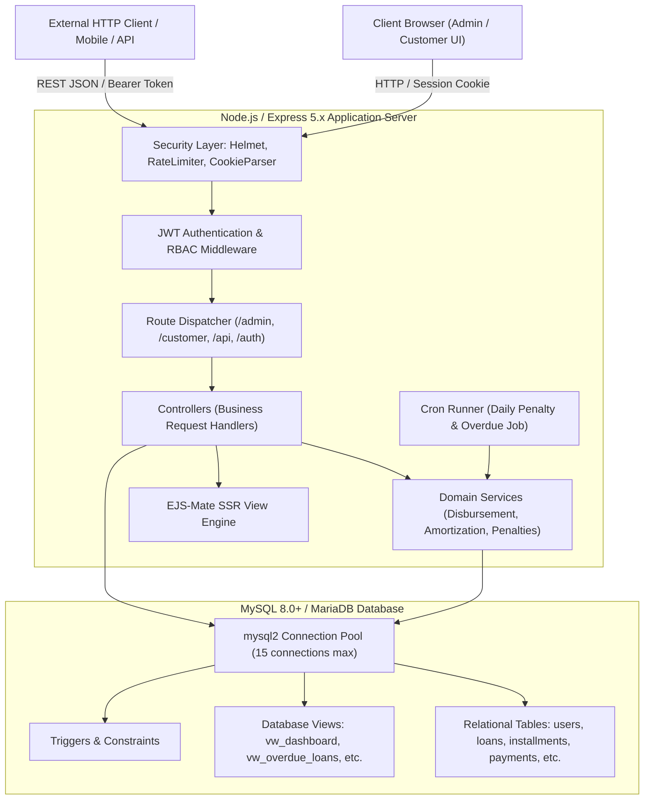
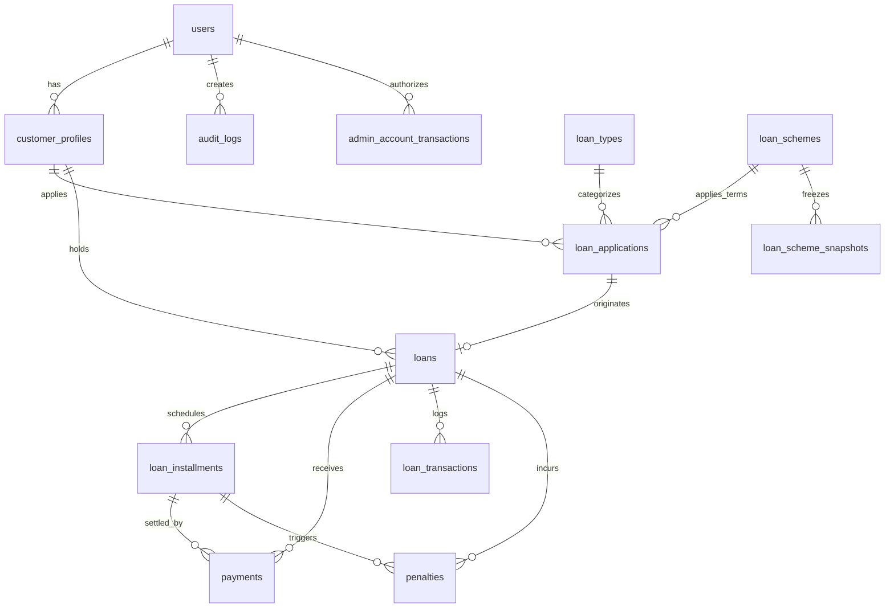

# Amanah Capital — Microfinance Loan Management System
## Comprehensive Architecture, Codebase Breakdown & Engineering Documentation

---

## 1. Executive Summary & Objective

**Amanah Capital** is an enterprise-grade Microfinance Loan Management System (LMS) engineered with a Node.js/Express backend, MySQL/MariaDB relational database, and Server-Side Rendered (SSR) EJS user interfaces. 

### Core Objectives
1. **Borrower Lifecycle Management**: Complete handling of customer profiles, KYC information (Aadhaar, PAN, contact addresses), account activation, and deactivation.
2. **Dynamic Loan Schemes**: Multi-scheme architecture supporting flexible lending terms across Daily, Weekly, and Monthly repayment frequencies with customized interest structures.
3. **End-to-End Application & Approval Workflow**: Application origination, officer review, dynamic parameter overrides upon approval, and controlled disbursement.
4. **Treasury & Disbursement Governance**: Integrated administrative capital treasury with real-time balance tracking, atomic fund disbursements, and balance verification.
5. **Offline Repayment Collection**: Physical and digital offline payment recording (Cash, UPI, Bank Transfer, Cheque) performed by authorized officers with automatic amortization schedule reconciliation.
6. **Automated Risk & Penalty Engine**: Automated daily cron jobs that detect overdue installments, respect customizable grace periods, apply flat or percentage penalties, and enforce maximum caps.
7. **Compliance & Auditability**: Non-repudiation and traceability via system-wide audit logging (`audit_logs`) tracking administrative actions with IP addresses and timestamps.

---

## 2. Technology Stack & Runtime Architecture



| Layer | Technologies & Dependencies | Purpose |
|---|---|---|
| **Runtime & Framework** | Node.js (v20+ / v24 ESM), Express 5.x | High-throughput async non-blocking execution core |
| **Database & Driver** | MySQL 8.0+ / MariaDB 10.11+, `mysql2/promise` | ACID-compliant storage with connection pooling and transactions |
| **Authentication & AuthZ** | `jsonwebtoken`, `bcrypt` (10 rounds), Cookie parser | Token-based auth stored in HttpOnly cookies, RBAC enforcement |
| **Security Layer** | `helmet` (CSP directives), `express-rate-limit` | Defense against XSS, clickjacking, brute-force attacks |
| **Templating Engine** | EJS, `ejs-mate`, `express-ejs-layouts` | Layout inheritance, reusable partials, component-based SSR |
| **Scheduling** | `node-cron` (v4.6) | Midnight automated batch execution for loan penalties |
| **Export & Reporting** | `exceljs`, `csv-writer` | Financial dossier export, portfolio Excel/CSV streaming |
| **Process Management** | cPanel Phusion Passenger, PM2 (`ecosystem.config.cjs`) | Zero-downtime reloads via `tmp/restart.txt`, memory ceilings |

---

## 3. Data Storage & Retrieval Architecture

### 3.1 Database Connection Pool (`config/db.js`)
* Configured using `mysql2/promise` creating a centralized `mysql.createPool`:
  * `connectionLimit: 15`: Prevents database connection exhaustion under load.
  * `waitForConnections: true` and `queueLimit: 0`: Queues queries when all connections are busy.
  * SSL support: Dynamically configurable via `DB_USE_SSL` environment variable.

### 3.2 Transactional Integrity & Concurrency Control
Critical state changes use atomic database transactions:
```javascript
const connection = await pool.getConnection();
try {
  await connection.beginTransaction();
  // ... Operations with SELECT ... FOR UPDATE (Pessimistic Locking)
  await connection.commit();
} catch (error) {
  await connection.rollback();
  throw error;
} finally {
  connection.release();
}
```
* **Pessimistic Locking (`FOR UPDATE`)**:
  * Used in `accountModel.js` when adding capital to prevent double-crediting.
  * Used in `disbursementService.js` to ensure the admin treasury balance isn't overdrawn.
  * Used in `paymentController.js` to lock target installments and the parent loan during repayment reconciliation.

### 3.3 Relational Entity Model & Schema Breakdown



1. **`users`**: Authentication table. Contains `user_code`, `email`, `password_hash`, `role` (`ADMIN`, `CUSTOMER`), `account_status` (`ACTIVE`, `INACTIVE`, `BLOCKED`), and `force_password_change`.
2. **`customer_profiles`**: Demographic, KYC, and personal identifiers: `customer_code`, `full_name`, `phone`, `aadhaar_number`, `pan_number`, `address`, `profile_status`.
3. **`loan_types` & `loan_schemes`**:
   * `loan_types`: High-level categories (e.g., Personal Loan, Business Loan) defining duration limits and fee percentages.
   * `loan_schemes`: Definitive loan products specifying `repayment_frequency` (`DAILY`, `WEEKLY`, `MONTHLY`), `base_interest_rate`, `duration_value`, `duration_unit`, and `penalty_mode` (`INHERIT_FREQUENCY_DEFAULT` or `CUSTOM`).
4. **`loan_applications`**: Pre-approval pipeline storing `requested_amount`, `monthly_income`, `purpose`, and `application_status` (`PENDING`, `UNDER_REVIEW`, `APPROVED`, `REJECTED`, `CANCELLED`).
5. **`loans`**: Active loan contracts created post-disbursement. Stores `loan_number`, `principal_amount`, `annual_interest_rate`, `tenure_months`, `emi_amount`, `total_interest`, `total_payable`, `outstanding_balance`, `disbursement_date`, and `loan_status` (`ACTIVE`, `COMPLETED`, `CLOSED`, `DEFAULTED`).
6. **`loan_installments`**: Granular amortization schedule rows. Tracks `installment_number`, `due_date`, `installment_amount`, `principal_component`, `interest_component`, `paid_amount`, and `status` (`PENDING`, `PAID`, `OVERDUE`).
7. **`payments`**: Payment ledger records. Stores `receipt_number`, `payment_amount`, `payment_method` (`CASH`, `UPI`, `BANK_TRANSFER`, `CHEQUE`), `transaction_reference`, and `collected_by`.
8. **`admin_account` & `admin_account_transactions`**: Treasury reserve. Tracks operational lending liquidity with real-time balance checks and ledger entries (`CREDIT` on deposit, `DEBIT` on loan disbursement).
9. **`penalties`**: Tracks fines assessed on overdue installments with status (`APPLIED`, `WAIVED`, `PAID`).
10. **`audit_logs`**: System audit trail logging `user_id`, `module_name`, `entity_name`, `entity_id`, `action`, `description`, and client `ip_address`.
11. **`system_settings`**: Global platform key-value settings for company branding, currency, grace periods, and auto-penalty rules.

### 3.4 High-Performance Analytical Views
* **`vw_dashboard`**: Real-time aggregation of active loans count, total portfolio value, active borrower counts, and pending applications.
* **`vw_overdue_loans`**: Instant view identifying loans with overdue installments, outstanding default balances, and delinquency metrics.
* **`vw_monthly_collection`**: Monthly historical collections for charting and financial reporting.
* **`vw_customer_summary`**: Customer metrics linking active loan count, total borrowed amount, and default status.

---

## 4. Deep-Dive: File & Component Breakdown

### 4.1 Application Initialization & Runtime

* **[`server.js`](file:///c:/Users/Khairul/OneDrive/Desktop/AmanaCapital/Aman%20Capital/amana-capital/server.js)**:
  * Application startup script. Loads environment variables with fallback configuration.
  * Connects to MySQL, handles connection errors gracefully, and binds Express to the designated network port (`PORT || 8080`).
  * Listens for termination signals (`SIGTERM`, `SIGINT`) for graceful shutdown.

* **[`app.js`](file:///c:/Users/Khairul/OneDrive/Desktop/AmanaCapital/Aman%20Capital/amana-capital/app.js)**:
  * Core Express application assembly.
  * Configures middleware: Helmet (CSP directives for CDN assets like FontAwesome and Chart.js), CORS, Express Rate Limiters, Cookie Parser, Body Parsers (`urlencoded`, `json`).
  * Configures EJS-Mate templating and registers static asset paths (`/public`, `/vendor`).
  * Implements JWT authentication parsing middleware: extracts tokens from cookies, queries user status for deactivation detection, and resolves user permissions into `res.locals`.
  * Mounts application route groups (`/api`, `/auth`, `/admin`, `/customer`).

---

### 4.2 Controllers (`controllers/`)

* **[`authController.js`](file:///c:/Users/Khairul/OneDrive/Desktop/AmanaCapital/Aman%20Capital/amana-capital/controllers/authController.js)**:
  * Manages authentication lifecycle: `login`, `register`, `logout`, `refreshToken`.
  * **Login Logic**: Supports flexible credential lookups (User Code, Email, or Customer Phone number via a `customer_profiles` JOIN). Performs BCrypt hash comparison, checks if the account is `ACTIVE`, and verifies `force_password_change`. Generates signed JWTs (1-day expiration) stored inside secure, HttpOnly cookies. Directs users based on role (`/admin/dashboard` vs `/customer/dashboard`).

* **[`adminLoanHubController.js`](file:///c:/Users/Khairul/OneDrive/Desktop/AmanaCapital/Aman%20Capital/amana-capital/controllers/adminLoanHubController.js)**:
  * Central administrative control hub for loan monitoring and servicing.
  * Renders active loans, approved applications pending disbursement, completed accounts, and defaulted files.
  * Provides search, frequency filtering, status categorization, and pagination.

* **[`adminCustomerController.js`](file:///c:/Users/Khairul/OneDrive/Desktop/AmanaCapital/Aman%20Capital/amana-capital/controllers/adminCustomerController.js)**:
  * Manages the complete Customer Relationship dossier.
  * `createCustomer`: Generates user credential records (`users`), creates matching KYC profiles (`customer_profiles`), and writes audit logs.
  * `getCustomerDetails`: Compiles individual customer portfolio—linking active loans, repayment histories, and pending applications.
  * `createApplication`: Initiates an application on behalf of a customer, verifying unresolved applications first.

* **[`loanApplicationController.js`](file:///c:/Users/Khairul/OneDrive/Desktop/AmanaCapital/Aman%20Capital/amana-capital/controllers/loanApplicationController.js)**:
  * Manages the credit evaluation lifecycle:
  * `submitApplication`: Customer or officer submission with input sanitization and duplicate checking.
  * `approveApplication`: Officers select or override loan scheme parameters (tenure, interest rate), transition status to `APPROVED`, and prepare the application for disbursement.
  * `rejectApplication`: Rejection recording with administrative rationale and timestamping.

* **[`disbursementService.js`](file:///c:/Users/Khairul/OneDrive/Desktop/AmanaCapital/Aman%20Capital/amana-capital/services/disbursementService.js)**:
  * Executes atomic, transactional loan disbursement:
    1. Validates that the application is `APPROVED` and undisbursed.
    2. Checks treasury reserves in `admin_account` against the requested loan amount.
    3. Generates unique loan identifiers (`LN-YYYYMMDD-XXXX`).
    4. Creates the loan record in `loans`.
    5. Deducts disbursed capital from `admin_account` and creates an audit transaction in `admin_account_transactions`.
    6. Calls `loanSchemeAssignmentService` to generate the complete installment schedule.
    7. Sets loan status to `ACTIVE` and logs a `DISBURSEMENT` transaction in `loan_transactions`.

* **[`paymentController.js`](file:///c:/Users/Khairul/OneDrive/Desktop/AmanaCapital/Aman%20Capital/amana-capital/controllers/paymentController.js)**:
  * Processes repayment transactions:
  * Accepts installment payment details, checks for overpayment/underpayment, and creates a `payments` ledger record.
  * Updates installment status to `PAID` (or partial) and reduces `outstanding_balance` on the parent loan.
  * Automatically marks the loan as `CLOSED`/`COMPLETED` once all installments are satisfied.

* **[`accountController.js`](file:///c:/Users/Khairul/OneDrive/Desktop/AmanaCapital/Aman%20Capital/amana-capital/controllers/accountController.js)**:
  * Manages the administrative treasury account (`admin_account`).
  * `addFunds`: Handles capital top-ups with validation on method (Cash, UPI, Bank Transfer, Cheque) and reference numbers, updating account balance atomically with audit logs.

* **[`dashboardController.js`](file:///c:/Users/Khairul/OneDrive/Desktop/AmanaCapital/Aman%20Capital/amana-capital/controllers/dashboardController.js)**:
  * Aggregates executive KPIs: active lending portfolio size, collection efficiency, overdue loan rates, and borrower growth metrics.

* **[`reportController.js`](file:///c:/Users/Khairul/OneDrive/Desktop/AmanaCapital/Aman%20Capital/amana-capital/controllers/reportController.js)**:
  * Produces operational intelligence: overdue delinquency reports, collection logs, and portfolio performance metrics.

* **[`schemeController.js`](file:///c:/Users/Khairul/OneDrive/Desktop/AmanaCapital/Aman%20Capital/amana-capital/controllers/schemeController.js)**:
  * CRUD controller for managing loan schemes, interest calculations, and penalty rules.

* **[`settingsController.js`](file:///c:/Users/Khairul/OneDrive/Desktop/AmanaCapital/Aman%20Capital/amana-capital/controllers/settingsController.js)**:
  * Manages global settings stored in `system_settings`: institution identity, branding logos, contact info, default penalty policies, and currency configurations.

---

### 4.3 Services (`services/`)

* **[`loanSchemeAssignmentService.js`](file:///c:/Users/Khairul/OneDrive/Desktop/AmanaCapital/Aman%20Capital/amana-capital/services/loanSchemeAssignmentService.js)** & **[`scheduleService.js`](file:///c:/Users/Khairul/OneDrive/Desktop/AmanaCapital/Aman%20Capital/amana-capital/services/scheduleService.js)**:
  * Financial engine responsible for amortization calculations.
  * Supports multiple repayment intervals:
    * `DAILY`: Day-by-day installment progression.
    * `WEEKLY`: 7-day payment intervals.
    * `MONTHLY`: Standard calendar-month amortizations.
  * Computes principal components, interest amounts, and generates installment schedules.
  * Freezes loan scheme parameters at the time of disbursement into `loan_scheme_snapshots` to protect active loans against subsequent scheme modifications.

* **[`penaltyService.js`](file:///c:/Users/Khairul/OneDrive/Desktop/AmanaCapital/Aman%20Capital/amana-capital/services/penaltyService.js)** & **[`penaltyPolicyService.js`](file:///c:/Users/Khairul/OneDrive/Desktop/AmanaCapital/Aman%20Capital/amana-capital/services/penaltyPolicyService.js)**:
  * Handles loan delinquency and penalty assessments.
  * Inspects overdue installments where `due_date < CURRENT_DATE` and status is not `PAID`.
  * Checks configured grace periods; if expired, calculates fine values (Flat Fee or Percentage of Overdue Principal) while enforcing maximum penalty caps.
  * Records assessments in `penalties` and increments loan payable balances.

* **[`customerExportService.js`](file:///c:/Users/Khairul/OneDrive/Desktop/AmanaCapital/Aman%20Capital/amana-capital/services/customerExportService.js)**:
  * Streams customer and loan data to formatted Excel worksheets (`.xlsx`) or CSV files using `exceljs`.

* **[`customerDeletionService.js`](file:///c:/Users/Khairul/OneDrive/Desktop/AmanaCapital/Aman%20Capital/amana-capital/services/customerDeletionService.js)**:
  * Implements safe customer archiving: verifies that no active or unclosed loans exist prior to allowing record removal.

---

### 4.4 Automated Background Jobs (`jobs/`)

* **[`penaltyJob.js`](file:///c:/Users/Khairul/OneDrive/Desktop/AmanaCapital/Aman%20Capital/amana-capital/jobs/penaltyJob.js)**:
  * Automated scheduled cron task using `node-cron`.
  * Runs nightly at midnight (`0 0 * * *`).
  * Queries all active installments, marks unpaid past-due installments as `OVERDUE`, and invokes `penaltyService` to apply overdue penalties automatically.

---

### 4.5 Middleware (`middleware/`)

* **[`authMiddleware.js`](file:///c:/Users/Khairul/OneDrive/Desktop/AmanaCapital/Aman%20Capital/amana-capital/middleware/authMiddleware.js)**: Verifies presence and validity of the JWT cookie.
* **[`rbacMiddleware.js`](file:///c:/Users/Khairul/OneDrive/Desktop/AmanaCapital/Aman%20Capital/amana-capital/middleware/rbacMiddleware.js)**: Guards administrative routes, ensuring only authorized user roles access administrative endpoints.
* **[`permissionMiddleware.js`](file:///c:/Users/Khairul/OneDrive/Desktop/AmanaCapital/Aman%20Capital/amana-capital/middleware/permissionMiddleware.js)**: Fine-grained permission evaluator resolving role permissions into boolean helpers in EJS templates.
* **[`validationMiddleware.js`](file:///c:/Users/Khairul/OneDrive/Desktop/AmanaCapital/Aman%20Capital/amana-capital/middleware/validationMiddleware.js)**: Uses `express-validator` to enforce input constraints on requests.

---

## 5. Code Quality & Architectural Assessment

### 5.1 Architectural Strengths
1. **Strong Transactional Safety**: Sensitive operations (disbursements, repayments, capital top-ups) consistently use database transactions (`connection.beginTransaction()`, `commit()`, `rollback()`), preventing data corruption.
2. **Defensive Concurrency Control**: Uses pessimistic locking (`SELECT ... FOR UPDATE`) across treasury balances and installment payments to guard against race conditions.
3. **Audit Trail**: Administrative actions (account updates, status changes, approvals, deletions) are recorded in `audit_logs` with client IP tracking.
4. **Parameterized SQL Queries**: Database operations consistently use parameterized inputs (`?` placeholders), protecting against SQL injection attacks.
5. **Scheme Snapshotting**: Disbursed loans freeze scheme rules into `loan_scheme_snapshots`, ensuring changes to general loan schemes do not retroactively alter existing contracts.

### 5.2 Areas for Improvement & Recommended Refactoring
1. **Repository/Model Layer Consistency**:
   * *Current State*: Some controllers execute raw SQL queries directly via `db.query(...)` rather than calling methods in their corresponding `models/` file.
   * *Recommendation*: Migrate remaining inline SQL queries into dedicated model/repository classes to maintain clean separation of concerns and simplify unit testing.
2. **Permission Model Simplification**:
   * *Current State*: The system contains both role-based checks (`role === 'ADMIN'`) and fine-grained permission lookups (`requirePermission(...)`).
   * *Recommendation*: Standardize on a unified RBAC/permission matrix to ensure consistent authorization checks across all endpoints.
3. **Automated Test Coverage**:
   * *Current State*: Test files currently reside in `scripts/tests/` and `jobs/` as manual execution scripts.
   * *Recommendation*: Integrate automated testing using Jest and Supertest (`npm test`) in CI/CD pipelines to validate critical business logic automatically.

---

## 6. Environment Configuration Reference

The application is configured using environment variables defined in `.env`:

| Key | Example Value | Description |
|---|---|---|
| `PORT` | `8080` | Express HTTP network listening port |
| `NODE_ENV` | `development` / `production` | Runtime mode (controls logging verbosity and cookie security) |
| `DB_HOST` | `localhost` | MySQL/MariaDB server host |
| `DB_PORT` | `3306` | MySQL server listening port |
| `DB_USER` | `root` | Database user account |
| `DB_PASSWORD` | `********` | Database user password |
| `DB_NAME` | `microfinance_services` | Primary database name |
| `DB_USE_SSL` | `false` | Enable/disable SSL for database connections |
| `JWT_SECRET` | `super_secret_jwt_key_...` | Cryptographic secret for signing JWT auth tokens |
| `SESSION_SECRET` | `super_secret_session_...` | Secret key for session management |
| `RATE_LIMIT_AUTH_MAX` | `100` | Maximum authentication attempts allowed per window |
| `RATE_LIMIT_WINDOW_MS` | `900000` | Rate limiting sliding window duration (in milliseconds) |

---

## 7. Operations & Deployment Runbook

### Starting in Development
```bash
npm run dev
```

### Starting in Production
```bash
npm start
# Or using PM2 process manager
pm2 start ecosystem.config.cjs
```

### Automated Background Worker
The automated overdue penalty engine initializes automatically with the server lifecycle in `jobs/penaltyJob.js` and runs on a daily schedule.

---

## 8. Whole-Rupee EMI Distribution & Upward Rounding Engine

### 8.1 Business Purpose & Scope
In operational microfinance collections, collecting installments containing paise or fractional rupees creates friction in physical field collections and cash handling. To eliminate fractional payments completely:
* **All Repayment Frequencies**: Whole-rupee calculation is strictly enforced across `DAILY`, `WEEKLY`, and `MONTHLY` loans.
* **Zero Fractional Paise in Installments**: Every generated installment amount (`total_amount`) is guaranteed to be an exact positive integer rupee value (e.g. ₹171, ₹172).

### 8.2 Financial Formulas & Upward Rounding
1. **Exact Total Payable**:
   $$\text{Exact Total Payable} = \text{Approved Principal} + \text{Approved Flat Interest}$$
2. **Rounded Total Payable (Ceiling Upward Rounding)**:
   $$\text{Rounded Total Payable} = \lceil\text{Exact Total Payable}\rceil$$
   *(e.g., ₹1,200.00 → ₹1,200; ₹1,200.01 → ₹1,201; ₹1,200.50 → ₹1,201).*
3. **Separate Rounding Adjustment Accounting**:
   $$\text{Rounding Adjustment} = \text{Rounded Total Payable} - \text{Exact Total Payable}$$
   The rounding adjustment is **never** silently added into the flat interest amount. It is preserved in dedicated schema columns (`approved_rounding_adjustment`, `rounding_adjustment`) for financial auditing and reporting.

### 8.3 Front-Loaded Higher EMI & Back-Loaded Lower EMI Algorithm
Using the installment count $N$ determined by the schedule engine:
1. **Base EMI**:
   $$\text{baseEMI} = \lfloor \text{Rounded Total Payable} / N \rfloor$$
2. **Remainder (Higher EMI Count)**:
   $$\text{remainder} = \text{Rounded Total Payable} \pmod N$$
3. **Deterministic Front-Loaded Sequencing**:
   * For installment index $i \in [0, N - 1]$ (chronological order):
     * If $i < \text{remainder}$: $\text{EMI}_i = \text{baseEMI} + 1$ (Higher Whole-Rupee Installment)
     * If $i \ge \text{remainder}$: $\text{EMI}_i = \text{baseEMI}$ (Lower Whole-Rupee Installment)
   * **Guarantee**:
     - Higher whole-rupee installments appear **first** ($1$ to $\text{remainder}$).
     - Lower whole-rupee installments appear **last** ($\text{remainder} + 1$ to $N$).
     - The difference between any two installments across the entire schedule is at most ₹1:
       $$(\text{baseEMI} + 1) - \text{baseEMI} \le 1$$
     - Total scheduled sum equals the rounded total payable exactly:
       $$\text{remainder} \times (\text{baseEMI} + 1) + (N - \text{remainder}) \times \text{baseEMI} = \text{Rounded Total Payable}$$

**Example**:
* Principal: ₹5,000 | Flat Interest: ₹500 | Total Payable: ₹5,500 | Installments: 120
* $\text{baseEMI} = \lfloor 5500 / 120 \rfloor = 45$
* $\text{remainder} = 5500 \pmod{120} = 100$
* **Generated Schedule**:
  * Installments 1–100: **₹46 each** (100 installments)
  * Installments 101–120: **₹45 each** (20 installments)
  * Total Scheduled: $100 \times 46 + 20 \times 45 = 4600 + 900 = \text{₹5,500}$

### 8.4 Mathematical Reconciliation Rules
All installment schedules strictly satisfy:
$$\sum_{k=1}^N \text{principal\_component}_k = \text{Approved Principal}$$
$$\sum_{k=1}^N \text{interest\_component}_k = \text{Approved Flat Interest}$$
$$\sum_{k=1}^N \text{rounding\_adjustment}_k = \text{Total Rounding Adjustment}$$
$$\sum_{k=1}^N \text{installment\_amount}_k = \text{Rounded Total Payable}$$
$$\text{principal\_component}_k + \text{interest\_component}_k + \text{rounding\_adjustment}_k = \text{installment\_amount}_k \quad (\forall k \in [1, N])$$

---

## 9. Frequency-Based Penalty & Late Fee Engine

### 9.1 Overview & Architecture
The system provides frequency-specific penalty policies (`DAILY`, `WEEKLY`, `MONTHLY`) managed at `/admin/settings?tab=penalty` and stored in `penalty_settings`. Each repayment frequency independently supports two calculation modes:

1. **Percentage of Overdue (`PERCENTAGE_OF_OVERDUE`)**:
   $$\text{Penalty Amount} = \frac{\text{Eligible Overdue Amount} \times \text{Penalty Rate}}{100}$$
   where $\text{Eligible Overdue Amount} = \text{total\_amount} - \text{paid\_amount}$.

2. **Fixed Rupee Amount (`FIXED_AMOUNT`)**:
   $$\text{Penalty Amount} = \text{Fixed Penalty Amount (₹)}$$
   applied as an exact rupee late fee per eligible overdue installment.

### 9.2 Grace Period & Eligibility Guard
* **Grace Period**: Number of days after `due_date` before penalty becomes applicable:
  $$\text{Effective Due Date} = \text{due\_date} + \text{grace\_period\_days}$$
  Penalties apply only when $\text{Effective Due Date} < \text{CURDATE()}$.
* **Status Inclusivity**: Evaluates installments with status `PENDING`, `PARTIALLY_PAID`, or `OVERDUE`.
* **Idempotency Guard**: An installment receives a `LATE_PAYMENT` penalty at most once, enforced by a unique key on `(installment_id, penalty_type)` in the `penalties` table.

### 9.3 Cumulative Maximum Penalty Cap Enforcement
To comply with microfinance regulations and prevent predatory fee accumulation, penalties are strictly capped relative to the approved loan principal:
$$\text{Maximum Allowed Penalty} = \frac{\text{Principal Amount} \times \text{Maximum Penalty Cap (\%)}}{100}$$
$$\text{Remaining Penalty Capacity} = \text{Maximum Allowed Penalty} - \text{Cumulative Applied Penalties}$$
$$\text{Effective Penalty} = \min(\text{Calculated Penalty}, \max(0, \text{Remaining Penalty Capacity}))$$

### 9.4 Accounting & Payment Waterfall
1. **Base Schedule Preservation**: Applying or waiving penalties increments or decrements `loan_installments.penalty_amount` while preserving scheduled `total_amount` as the scheduled baseline.
2. **Repayment Waterfall**: Payments allocated to an overdue installment strictly settle:
   $$\text{Payment} \longrightarrow \text{Penalty Paid} \longrightarrow \text{Interest Paid} \longrightarrow \text{Principal Paid}$$
   Penalties are liquidated first before reducing loan interest or principal.

---

## 10. Production Performance, Security & cPanel Optimization

### 10.1 Database Connection Pooling & Keep-Alive
- **Pool Sizing**: Configured dynamically via `DB_CONNECTION_LIMIT` (default 20), preventing process exhaustion on shared/cPanel hosting while maintaining high query throughput.
- **Connection Keep-Alive**: `enableKeepAlive: true` and `keepAliveInitialDelay: 10000` prevents TCP timeout drops and connection resets common in shared hosting environments.
- **Date Consistency**: `dateStrings: true` guarantees date fields (`YYYY-MM-DD`) remain unaffected by host server timezone offsets.

### 10.2 Production Performance Indexes (V8 Migration)
Applied indexes to convert full-table scans to sub-50ms index seeks:
* **`loans`**: `idx_loans_status` (`loan_status`), `idx_loans_disbursement_date` (`disbursement_date`), `idx_loans_customer_status` (`customer_id`, `loan_status`).
* **`loan_installments`**: `idx_installments_status` (`installment_status`), `idx_installments_due_date` (`due_date`), `idx_installments_status_due` (`installment_status`, `due_date`), `idx_installments_loan_status` (`loan_id`, `installment_status`).
* **`payments`**: `idx_payments_date` (`payment_date`), `idx_payments_loan_date` (`loan_id`, `payment_date`), `idx_payments_method` (`payment_method`).
* **`loan_applications`**: `idx_applications_status` (`application_status`), `idx_applications_created` (`created_at`), `idx_applications_customer_status` (`customer_id`, `application_status`).
* **`audit_logs`**: `idx_audit_created` (`created_at`), `idx_audit_module_created` (`module_name`, `created_at`).
* **`customer_profiles`**: `idx_customer_created` (`created_at`).
* **`penalties`**: `idx_penalties_status` (`status`).
* **`loan_transactions`**: `idx_transactions_date` (`transaction_date`), `idx_transactions_type` (`transaction_type`).
* **`admin_account_transactions`**: `idx_admin_created` (`created_at`), `idx_admin_txn_type` (`transaction_type`).

### 10.3 Network & Response Optimization
- **HTTP Payload Compression**: Enabled `compression()` middleware (gzip/deflate) with threshold 1KB, reducing response sizes by ~70%.
- **Static Asset Browser Caching**: Configured `maxAge: '7d'` in production (`1h` in dev) with `etag: true` for all assets in `/public` and vendor bundles (`/vendor/bootstrap`, `/vendor/fontawesome`, `/vendor/chartjs`, `/vendor/html2pdf`).
- **EJS View Cache**: Activated `app.set('view cache', true)` in production to eliminate disk re-reads and recompilations on template rendering.

### 10.4 Security & Operational Monitoring
- **Health Check Endpoint (`GET /health`)**: Returns real-time application uptime, database ping latency, and memory footprint (RSS, Heap). Suitable for cPanel and external uptime monitors.
- **Graceful Shutdown**: Intercepts `SIGTERM` and `SIGINT` to drain HTTP connections and cleanly close MySQL connection pools without abruptly dropping ongoing transactions.
- **Production Error Masking**: Prevents internal database schema, SQL errors, or stack traces from being exposed to clients on HTTP 500 responses in production.

